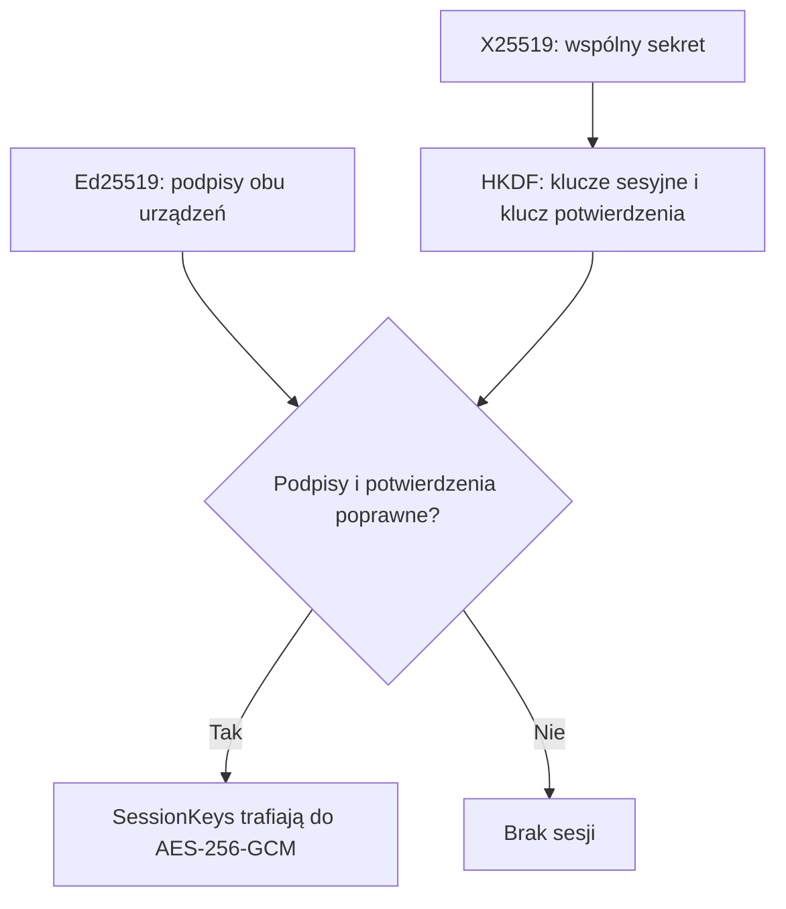
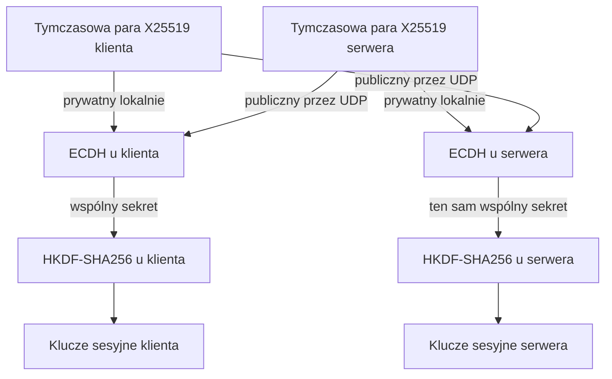

# Wymiana kluczy i uwierzytelnianie VPN

Zanim tunel zacznie przesyłać dane, klient i serwer potwierdzają swoją
tożsamość i ustalają świeże klucze do szyfrowania pakietów. Są to osobne zadania:

| Mechanizm | Do czego służy | Kiedy powstają klucze |
| --- | --- | --- |
| Ed25519 | Urządzenie podpisuje dane handshaku własnym kluczem prywatnym. Druga strona sprawdza podpis wcześniej zaufanym kluczem publicznym. | Raz na urządzenie, przez `keygen`. |
| X25519 | Obie strony wymieniają tymczasowe klucze publiczne i niezależnie obliczają ten sam sekret. | Przy każdym nowym połączeniu. |
| AES-256-GCM | Szyfruje i uwierzytelnia pakiety tunelu. HKDF-SHA256 wyprowadza ze wspólnego sekretu osobny klucz dla każdego kierunku. | Przy każdym nowym połączeniu. |

Klucz do wysyłania klienta jest kluczem do odbioru serwera. W przeciwnym
kierunku używany jest drugi klucz. Ani sekret X25519, ani klucze sesyjne
nie są wysyłane bezpośrednio przez sieć.




## Jak powstaje wspólny sekret?



Każda strona oblicza sekret **u siebie**, używając własnego klucza
prywatnego i publicznego klucza rozmówcy. Ani sekret, ani klucze
sesyjne nie przechodzą przez sieć.

Podpisy Ed25519 wiążą wymienione klucze X25519 z zaufanymi tożsamościami.
HKDF-SHA256 wyprowadza z sekretu i danych handshaku dwa klucze AES-GCM:
klucz do wysyłania klienta jest kluczem do odbierania serwera i odwrotnie.

## Gdzie jest kod?

- `infra/handshake/identity.go` generuje klucze Ed25519 i wczytuje własny klucz
  prywatny oraz zaufany publiczny klucz rozmówcy.
- `infra/handshake/classic.go` prowadzi handshake po UDP i zwraca `SessionKeys`
  zgodnie z interfejsem `KeyProvider` z `domain/crypto.go`.
- `main.go` obsługuje komendę `keygen`. Przy zwykłym uruchomieniu wykonuje
  handshake, przekazuje wynik do modułu AES-GCM i uruchamia ruch przez tunel.

## Uruchomienie: jedna VM i jeden klient

Na obu maszynach użyj Linuksa z TUN (klient może działać w WSL2 z TUN).
Skompiluj program w katalogu projektu (Go 1.23.2 lub nowsze):

```bash
go build -o vpn-daemon .
```

### 1. Wygeneruj tożsamości

Na każdej maszynie, w katalogu projektu:

```bash
./vpn-daemon keygen
```

`keygen` tworzy lokalny katalog `keys/` i zapisuje w nim dwa pliki PEM:
prywatny `identity.key` i publiczny `identity.pub`. Nie otwiera TUN, nie
łączy się z siecią i nie wymaga `sudo`. Jeśli katalog już istnieje,
komenda kończy się błędem i niczego nie nadpisuje. Przy kolejnych
połączeniach używaj tej samej pary.

Przekaż drugiej stronie tylko `keys/identity.pub` i zapisz otrzymany klucz
u siebie jako `keys/peer.pub`. Przykład z terminala klienta przez zaufane
połączenie SSH, gdy projekt na VM jest w `~/VPN-PQC`:

```bash
scp keys/identity.pub USER@ADRES_VM:VPN-PQC/keys/peer.pub
scp USER@ADRES_VM:VPN-PQC/keys/identity.pub keys/peer.pub
```

Prywatne pliki `identity.key` zostają na swoich urządzeniach. Domyślny
katalog `keys/` w repozytorium jest ignorowany przez Git.

### 2. Uruchom najpierw serwer, potem klienta

Uruchom VPN z katalogu, który zawiera `keys/`. Program domyślnie wczytuje
własny `keys/identity.key` i zaufany `keys/peer.pub`. Klient musi móc dotrzeć
do `9999/UDP` na VM. Na serwerze:

```bash
sudo ./vpn-daemon -mode=server -port=9999
```

Na kliencie, w ciągu 60 sekund od startu serwera:

```bash
sudo ./vpn-daemon -mode=client -server=ADRES_VM:9999
```

`ADRES_VM` to adres VM osiągalny z klienta. Gdy po obu stronach pojawi się
`Ustanowiono uwierzytelnioną sesję`, uruchom na kliencie
`ping -c 4 10.8.0.1`. To domyślny adres serwera wewnątrz tunelu.

Opcjonalnie `./vpn-daemon keygen inny-katalog` zapisze klucze w innym
katalogu. Wtedy przy starcie podaj ścieżki przez `-identity` i `-peer-key`.
Te flagi pozwalają też nadal używać kluczy wygenerowanych wcześniej.

## Test bez TUN i VM

```bash
go test ./infra/udp -run '^TestClassicExchange$' -v
```

Test generuje tożsamości tym samym kodem, co `keygen`, wczytuje pliki i wykonuje
handshake po lokalnym UDP. Zwrócone klucze trafiają do istniejącego modułu AES-GCM:
test sprawdza przesyłanie zaszyfrowanego pakietu w obie strony, świeże klucze
przy kolejnym połączeniu i odrzucenie niewłaściwego klucza publicznego.

Obecna wersja jest klasyczna. Po przejściu z Ed25519 na ML-DSA można zachować
polecenie `keygen`, podmieniając generator i format kluczy. Stare klucze Ed25519
nie zastąpią nowych tożsamości ML-DSA.
